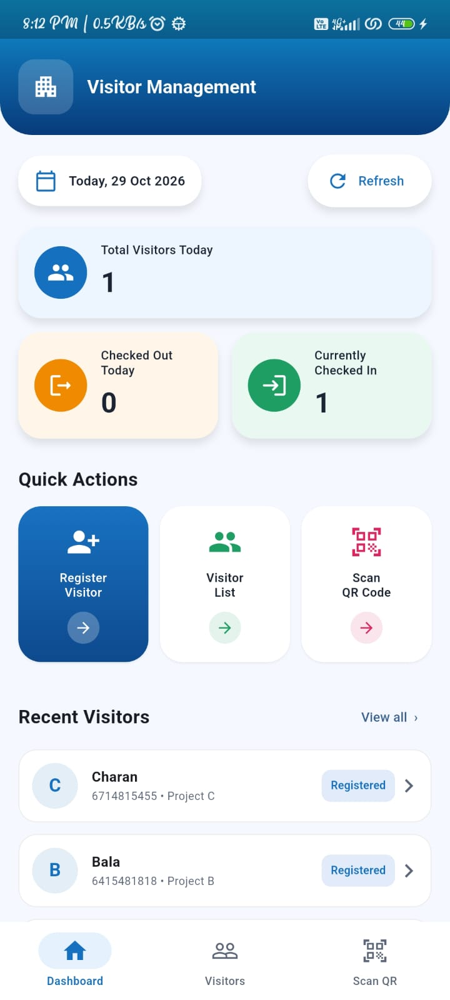
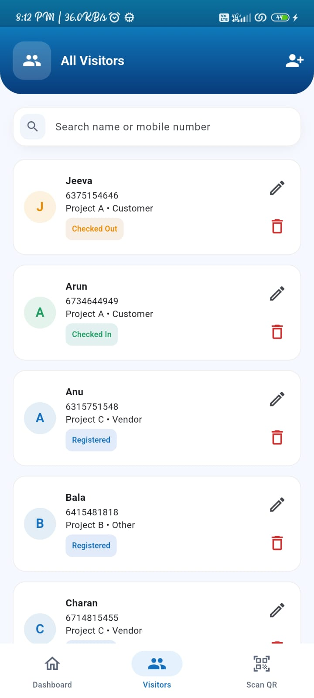
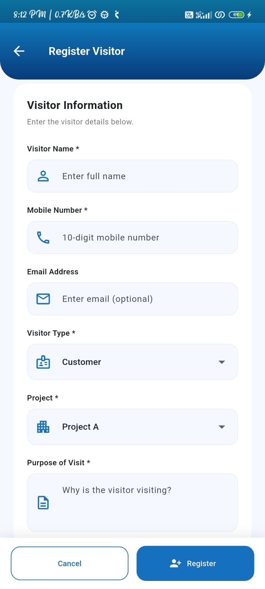
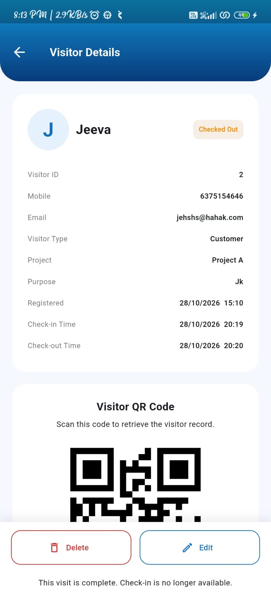
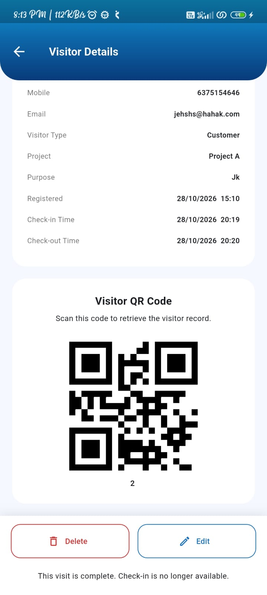
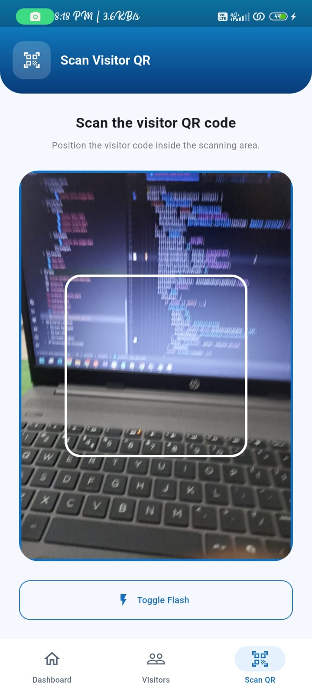

# Visitor Management Application

A Flutter Android app for front-desk and security staff to register visitors, manage visitor records, generate and scan QR codes, and record check-in / check-out activity. Data is stored through a mock REST API (MockAPI).

## Features

- **Dashboard:** Total visitors today, currently checked in, checked out today (calculated locally from the API records using the device's local date), shortcuts to Register / Visitor List / Scan QR, and recent visitors.
- **Visitor registration & edit:** Validated form (name and purpose required, mobile exactly 10 digits, optional email validated when entered, type and project dropdowns). New visitors start as `Registered`; after saving, the app opens the visitor's details screen with the generated QR code.
- **Visitor list:** Scrollable cards with name, mobile, project, type and status chip; search by name or mobile; edit and delete (with confirmation) icons; tap for details; pull-to-refresh; loading, empty and network-error states.
- **Visitor details:** Profile card, QR code (encodes the server-generated visitor ID), status, check-in/check-out timestamps and the check-in / check-out action.
- **QR scanner:** Camera preview, invalid-QR and unknown-visitor errors, protection against repeated scanner callbacks, camera-permission-denied message, navigates to the visitor details after a successful scan.
- **Workflow rules:** `Registered → Checked In → Checked Out`. No duplicate check-in, no check-out before check-in, completed visits cannot be checked in again. The list, details and dashboard update immediately.

## Flutter / Dart version

- Flutter 3.44.2 (stable)
- Dart 3.12.2

## Packages

| Package | Purpose |
| --- | --- |
| `flutter_bloc`, `equatable` | State management |
| `http` | REST API client |
| `qr_flutter` | QR code generation |
| `mobile_scanner` | QR code scanning |
| `bloc_test`, `mocktail` (dev) | Tests |

## State management: BLoC

A single `VisitorBloc` owns the visitor list, the selected visitor, the search query, the loading/success/failure status and error messages. BLoC was chosen because:

- every screen (dashboard, list, details, scanner) must show the same data, so a check-in on one screen updates the others and the dashboard counts without a restart;
- events (`LoadVisitors`, `RegisterVisitor`, `CheckInVisitor`, ...) make each user action explicit and easy to unit-test;
- derived data (search results, dashboard statistics) is computed from one state object, so it can never go out of sync.

Single-visitor lookups (details screen, QR scan) use their own `details*` statuses so they never flash the list screen's loading/error UI.

## Architecture

```
lib/
  core/        constants (API base URL), theme, ApiException
  data/        models (Visitor), services (HTTP), repositories (business rules)
  features/    dashboard, visitors (bloc + list), visitor_form, visitor_details, qr_scanner
  shared/      reusable widgets (CustomTextField, CustomButton, DashboardStatCard,
               VisitorCard, StatusChip, LoadingView, EmptyStateWidget) and helpers
```

UI widgets never call the API directly: UI → BLoC → `VisitorRepository` (status rules) → `VisitorApiService` (HTTP).

## Setup

1. Install Flutter 3.44.2 or newer and an Android emulator or device.
2. `flutter pub get`
3. `flutter run`

The app already points at the mock API below, so no further configuration is needed. To use your own MockAPI project, change `apiBaseUrl` in `lib/core/constants/app_constants.dart`.

Other commands:

```bash
flutter analyze
flutter test
flutter build apk --release   # build/app/outputs/flutter-apk/app-release.apk
```

## Mock API

- **Base URL:** `https://6ae16351be3bc8fead987247.mockapi.io/api/visitors`
- **Endpoints:** `GET /visitors`, `GET /visitors/{id}`, `POST /visitors`, `PUT /visitors/{id}`, `DELETE /visitors/{id}`. Check-in and check-out are saved with `PUT` (the full record is sent).
- MockAPI persists data, so records survive app restarts. The `id` is generated by the server and is what the QR code contains.

To recreate the API, create a MockAPI resource named `visitors` with these fields:

| Field | Type |
| --- | --- |
| id | Generated ID |
| name, mobile, email | String |
| visitor_type, project, purpose, status | String |
| created_at, check_in_time, check_out_time | String (ISO-8601) |

Sample record:

```json
{
  "id": "1",
  "name": "Rahul Sharma",
  "mobile": "9876543210",
  "email": "rahul@example.com",
  "visitor_type": "Customer",
  "project": "Project A",
  "purpose": "Site Visit",
  "status": "Registered",
  "created_at": "2026-10-26T04:30:00.000Z",
  "check_in_time": null,
  "check_out_time": null
}
```

## Screenshots

| Dashboard | Visitor List | Registration |
| --- | --- | --- |
|  |  |  |

| Visitor Details | Visitor QR Code | QR Scanner |
| --- | --- | --- |
|  |  |  |

## Known limitations

- Android only; tested on emulator/device with camera access required for scanning.
- One visit session per registration (no repeat-visit history).
- Check-in/check-out use `PUT` with the full record; they re-read the visitor first so stale data is not overwritten.
- No offline cache: an internet connection is required.
- Timestamps are stored in UTC and shown in the device's local time.
